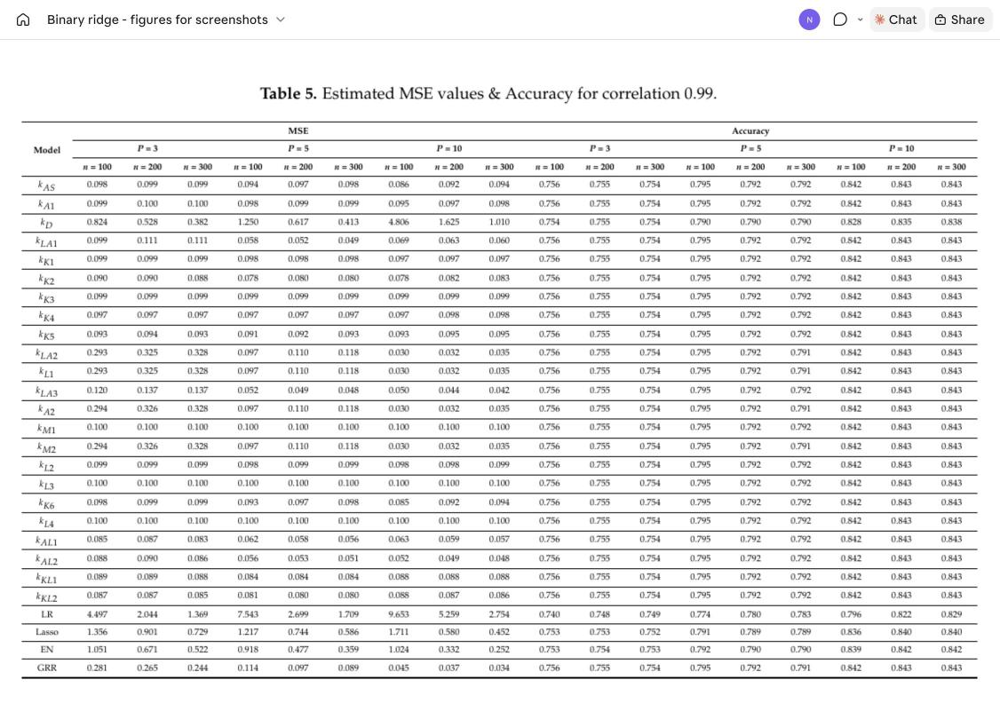
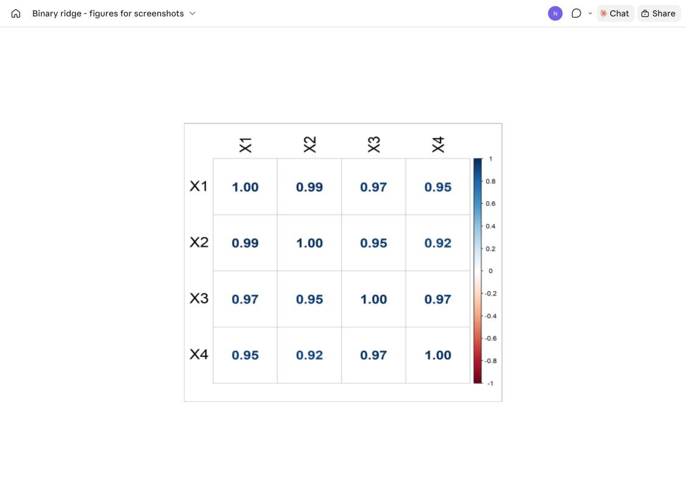
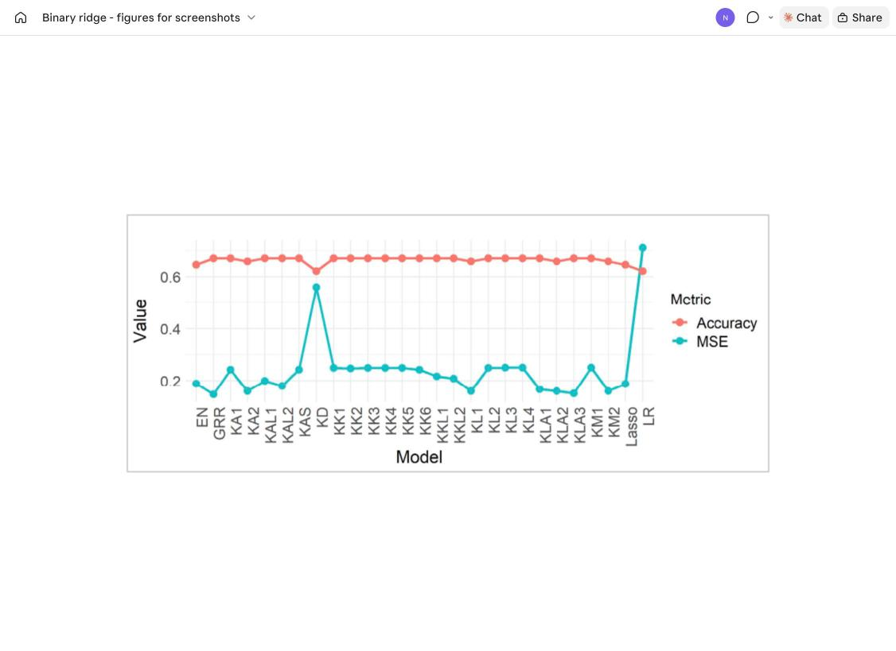
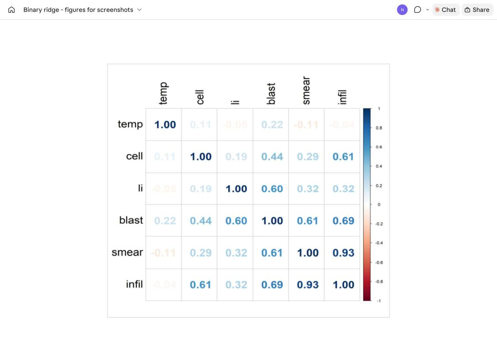

# Binary Ridge: MSE vs Accuracy

**Evaluating Estimator Performance Under Multicollinearity: A Trade-Off Between MSE and Accuracy in Logistic, Lasso, Elastic Net, and Ridge Regression with Varying Penalty Parameters**

HM Nayem, Sajeda Aziz, B. M. Golam Kibria (2025). *Stats*, 8(2), 45.

[](https://doi.org/10.3390/stats8020045)


The paper is open access and can be read at the DOI link above.

---

## Summary

When predictors in a logistic regression model are highly correlated, the maximum likelihood estimates become unstable. This paper compares **23 logistic ridge regression (LRR) estimators** (different choices of the ridge parameter k) with **logistic regression (LR)**, **Lasso**, **Elastic Net (EN)** and **generalized ridge regression (GRR)**. Each method is judged on two criteria at once:

- **MSE** of the estimated coefficients (how close θ̂ is to the true θ), and
- **classification accuracy** on a held-out test set (70% train / 30% test, threshold 0.5).

**Main findings**

- The ridge estimators **kAL1, kAL2, kKL1 and kKL2** give the lowest MSE and consistently high accuracy, especially for smaller samples, and their MSE falls as n grows.
- **GRR** performs best for large samples.
- **LR** has the highest MSE and the lowest accuracy, and **kD** is the least robust ridge estimator.
- Lasso and EN sit in between.

## Estimators compared

The logistic ridge estimator is $\hat\theta_{LRR} = (X'\hat W X + kI)^{-1} X'\hat W X\,\hat\theta_{ML}$, with k chosen by one of the 23 rules below (Table 1 of the paper). Code names refer to `compute_lambda()` in the scripts.

| Paper label | Code name | Source (paper's reference no.) |
|---|---|---|
| kAS | k1 | [41] |
| kA1 | k2 | [42] |
| kD | k3 | [25] |
| kLA1 | k4 | [27] |
| kK1 (median) | k5 | [36] |
| kK2 (max) | k7 | [36] |
| kK3 (min) | k6 | [36] |
| kK4 (geometric mean) | k8 | [36] |
| kK5 (harmonic mean) | k9 | [36] |
| kLA2 | k10 | [27] |
| kL1 | k11 | [32] |
| kLA3 | k12 | [27] |
| kA2 | k13 | [42] |
| kM1 | k14 | [43] |
| kM2 | k15 | [43] |
| kL2 | k16 | [32] |
| kL3 | k17 | [32] |
| kK6 | k18 | [21] |
| kL4 | k19 | [32] |
| kAL1 | k20 | [28] |
| kAL2 | k21 | [28] |
| kKL1 = σ̂ p^(1+p/n) | k23 | [34] |
| kKL2 = σ̂ max(p^(1+p/n), p^(1+1/p)) | k22 | [34] |
| LR | OLS (`glm`, binomial) | |
| Lasso / EN / GRR | Lasso / ElasticNet / OptimalRidge (`cv.glmnet`, alpha = 1, 0.5, 0) | |

kAS–kLA1 and kLA2–kL4 are among the best estimators identified by Mermi et al. (2024) [38]; kK1–kK5 come from Kibria (2023) [36] and kKL1–kKL2 from Kibria & Lukman (2020) [34].

## Simulation design (Section 2.4)

| Factor | Levels |
|---|---|
| Predictors P | 3, 5, 10 |
| Correlation ρ | 0.80, 0.90, 0.95, 0.99 |
| Sample size n | 100, 200, 300 |
| Replications | 5000 |
| Train / test split | 70% / 30% |
| Classification threshold | 0.5 |

Predictors: $X_{ij} = (1-\rho^2)^{1/2} d_{ij} + \rho\, d_{i(p+1)}$. The response is Bernoulli with a logit link. Following Newhouse & Oman (1971), the true θ in each replication is the normalized eigenvector of X′X linked to its largest eigenvalue (θ′θ = 1).

**Table 5** - MSE and accuracy for ρ = 0.99



## Real-data examples (Section 4)

### Example 1: Swedish municipal data (`data/sweden_municipal.csv`)

Statistics Sweden data on 271 municipalities. The first (unnamed) column is a row index, which the script drops.

| Column | Description |
|---|---|
| Y | 1 = net population grew, 0 = net population shrank |
| X1 | Population |
| X2 | Number of unemployed people |
| X3 | Number of newly constructed buildings |
| X4 | Number of bankrupt firms |

All correlations are above 0.90 (Figure 1), and the condition number is 38.33.

**Figure 1** - correlation matrix of the municipal data



**Figure 2** - MSE and accuracy of each estimator (Table 6)



GRR has the lowest MSE (0.147) and LR the highest (0.711). Most ridge estimators and GRR reach 67.1% accuracy, against 62.2% for LR and 64.6% for Lasso and EN.

### Example 2: Cancer remission data (`data/cancer_remission.csv`)

27 patients, 9 of whom reached complete remission.

| Column | Description |
|---|---|
| remiss | 1 = complete cancer remission, 0 = no remission |
| cell | Cellularity of the marrow clot section |
| smear | Smear differential percentage of blasts |
| infil | Percentage of absolute marrow leukemia cell infiltrate |
| li | Percentage labeling index of the bone marrow leukemia cells |
| blast | Absolute number of blasts in the peripheral blood |
| temp | Highest temperature before the start of treatment |

The condition number is 201.33 (Figure 3).

**Figure 3** - correlation matrix of the cancer remission data



In Table 7, kL2, kM1, kL3 and kL4 have the lowest MSE (about 0.11–0.13). LR, Lasso, EN and several ridge estimators reach 100% accuracy with very large MSE, which the paper attributes to overfitting in such a small sample.

## Repository structure

```
Binary-Ridge-MSE-Accuracy/
├── R/
│   ├── simulation_study.R             # Monte Carlo study (Section 2.4, Tables 2-5)
│   ├── example1_sweden_municipal.R    # Example 1, municipal data (Section 4.1)
│   └── example2_cancer_remission.R    # Example 2, cancer remission (Section 4.2)
├── data/
│   ├── sweden_municipal.csv
│   └── cancer_remission.csv
├── docs/                              # figures and tables from the paper
└── README.md
```

## How to run

```r
install.packages(c("MASS", "glmnet", "pls", "caret", "openxlsx", "psych",
                   "corrplot", "ggplot2", "tidyr"))
source("R/example1_sweden_municipal.R")
source("R/example2_cancer_remission.R")
source("R/simulation_study.R")   # slow: 72 settings x 5000 replications
```

Before running:

- The scripts read and write files at paths on the author's computer. Change the `read.csv()` path to `data/sweden_municipal.csv` or `data/cancer_remission.csv`, and change the output paths in `write.csv()` and `tiff()`.
- To test the simulation quickly, lower `num_simulations` (for example to 100).
- All scripts call `set.seed(12345678)`.

## Citation

```bibtex
@article{nayem2025evaluating,
  title   = {Evaluating Estimator Performance Under Multicollinearity: A Trade-Off Between MSE and Accuracy in Logistic, Lasso, Elastic Net, and Ridge Regression with Varying Penalty Parameters},
  author  = {Nayem, HM and Aziz, Sajeda and Kibria, B. M. Golam},
  journal = {Stats},
  volume  = {8},
  number  = {2},
  pages   = {45},
  year    = {2025},
  doi     = {10.3390/stats8020045}
}
```

## References

[1] Hosmer, D.W.; Lemeshow, S. Applied Logistic Regression, 2nd ed.; Wiley: New York, NY, USA, 2000.

[2] Menard, S.W. Logistic Regression: From Introductory to Advanced Concepts and Applications; Sage: Thousand Oaks, CA, USA, 2010.

[3] Allison, P.D. Logistic Regression Using SAS: Theory and Application; SAS Institute: Cary, NC, USA, 2012.

[4] Fox, J.; Monette, G. Generalized collinearity diagnostics. J. Am. Stat. Assoc. 1992, 87, 178–183.

[5] Gujarati, D.N. Basic Econometrics, 4th ed.; McGraw-Hill Higher Education: New York, NY, USA, 2002.

[6] Field, A. Discovering Statistics Using IBM SPSS Statistics; Sage Publications Limited: London, UK, 2024.

[7] Agresti, A. Foundations of Linear and Generalized Linear Models; John Wiley & Sons: Hoboken, NJ, USA, 2015.

[8] Hastie, T.; Tibshirani, R.; Friedman, J.H. The Elements of Statistical Learning: Data Mining, Inference, and Prediction; Springer: New York, NY, USA, 2009; Volume 2, pp. 1–758.

[9] Hoerl, A.E.; Kennard, R.W. Ridge regression: Biased estimation for nonorthogonal problems. Technometrics 1970, 12, 55–67.

[10] McDonald, G.C.; Schwing, R.C. Instabilities of regression estimates relating air pollution to mortality. Technometrics 1973, 15, 463–481.

[11] Hoerl, A.E.; Kannard, R.W.; Baldwin, K.F. Ridge regression: Some simulations. Commun. Stat.-Theory Methods 1975, 4, 105–123.

[12] McDonald, G.C.; Galarneau, D.I. A Monte Carlo evaluation of some ridge-type estimators. J. Am. Stat. Assoc. 1975, 70, 407–416.

[13] Lawless, J.F.; Wang, P. A simulation study of ridge and other regression estimators. Commun. Stat.-Theory Methods 1976, 5, 307–323.

[14] Dempster, A.P.; Schatzoff, M.; Wermuth, N. A simulation study of alternatives to ordinary least squares. J. Am. Stat. Assoc. 1977, 72, 104.

[15] Gibbons, D.G. A simulation study of some ridge estimators. J. Am. Stat. Assoc. 1981, 76, 131–139.

[16] Schaeffer, R.L.; Gunst, R.F.; Mason, R.L. A ridge logistic estimator. Commun. Stat.-Theory Methods 1984, 13, 99–113.

[17] Schaefer, R.L. Alternative estimators in logistic regression when the data are collinear. J. Stat. Comput. Simul. 1986, 25, 75–91.

[18] Walker, E.; Birch, J.B. Influence measures in ridge regression. Technometrics 1988, 30, 221–227.

[19] Kibria, B.M.G. Performance of some new ridge regression estimators. Commun. Stat.-Simul. Comput. 2003, 32, 419–435.

[20] Khalaf, G.; Shukur, G. Choosing ridge parameter for regression problems. Commun. Stat.-Theory Methods 2005, 34, 1177–1182.

[21] Muniz, G.; Kibria, B.M.G. On some ridge regression estimators: An empirical comparisons. Commun. Stat.-Simul. Comput. 2009, 38, 621–630.

[22] Månsson, K.; Shukur, G.; Kibria, B.M.G. A simulation study of some ridge regression estimators under different distributional assumptions. Commun. Stat.-Simul. Comput. 2010, 39, 1639–1670.

[23] Kibria, B.M.G.; Månsson, K.; Shukur, G. Performance of some logistic ridge regression estimators. Comput. Econ. 2012, 40, 401–414.

[24] Hefnawy, A.E.; Farag, A. A combined nonlinear programming model and Kibria method for choosing ridge parameter regression. Commun. Stat.-Simul. Comput. 2014, 43, 1442–1470.

[25] Aslam, M. Performance of Kibria’s method for the heteroscedastic ridge regression model: Some Monte Carlo evidence. Commun. Stat.-Simul. Comput. 2014, 43, 673–686.

[26] Dorugade, A.V. On comparison of some ridge parameters in ridge regression. Sri Lankan J. Appl. Stat. 2014, 15, 31.

[27] Arashi, M.; Valizadeh, T. Performance of Kibria’s methods in partial linear ridge regression model. Stat. Pap. 2015, 56, 231–246.

[28] Ayinde, K.; Lukman, A.F. Review and classification of the ridge parameter estimation techniques. Hacet. J. Math. Stat. 2016, 46, 1.

[29] Lukman, A.F.; Ayinde, K. Review and classifications of the ridge parameter estimation techniques. Hacet. J. Math. Stat. 2017, 46, 953–968.

[30] Melkumova, L.E.; Shatskikh, S.Y. Comparing ridge and LASSO estimators for data analysis. Procedia Eng. 2017, 201, 746–755.

[31] Herawati, N.; Nisa, K.; Setiawan, E. Regularized multiple regression methods to deal with severe multicollinearity. Int. J. Stat. Appl. 2018, 8, 167–172.

[32] Lukman, A.F.; Oluyemi, O.A.; Akanbi, O.B.; Clement, O.A. Classification-based ridge estimation techniques of Alkhamisi methods. J. Probab. Stat. Sci. 2018, 16, 165–181.

[33] Lukman, A.F.; Ayinde, K.; Binuomote, S.; Clement, O.A. Modified ridge-type estimator to combat multicollinearity: Application to chemical data. J. Chemom. 2019, 33, e3125.

[34] Kibria, B.M.G.; Lukman, A.F. A new ridge-type estimator for the linear regression model: Simulations and applications. Scientifica 2020, 2020, 9758378.

[35] Yüzbaşı, B.; Arashi, M.; Ejaz Ahmed, S. Shrinkage estimation strategies in generalised ridge regression models: Low/high-dimension regime. Int. Stat. Rev. 2020, 88, 229–251.

[36] Kibria, B.M.G. More than hundred (100) estimators for estimating the shrinkage parameter in a linear and generalized linear ridge regression models. J. Econom. Stat. 2023, 2, 233–252.

[37] Hoque, M.A.; Kibria, B.M. Some one and two parameter estimators for the multicollinear Gaussian linear regression model: Simulations and applications. Surv. Math. Its Appl. 2023, 18, 183–221.

[38] Mermi, S.; Akkuş, Ö.; Göktaş, A.; Gündüz, N. A new robust ridge parameter estimator having no outlier and ensuring normality for linear regression model. J. Radiat. Res. Appl. Sci. 2024, 17, 100788.

[39] Nayem, H.M.; Aziz, S.; Kibria, B.G. Comparison among ordinary least squares, ridge, lasso, and elastic net estimators in the presence of outliers: Simulation and application. Int. J. Stat. Sci. 2024, 24, 25–48.

[40] Hoque, M.A.; Kibria, B.M.G. Performance of some estimators for the multicollinear logistic regression model: Theory, simulation, and applications. Res. Stat. 2024, 2, 2364747.

[41] Alkhamisi, M.A.; Shukur, G. A Monte Carlo study of recent ridge parameters. Commun. Stat.-Simul. Comput. 2007, 36, 535–547.

[42] Alkhamisi, M.; Khalaf, G.; Shukur, G. Some modifications for choosing ridge parameters. Commun. Stat.-Theory Methods 2006, 35, 2005–2020.

[43] Muniz, G.; Kibria, B.M.G.; Månsson, K.; Shukur, G. On developing ridge regression parameters: A graphical investigation. Sort 2012, 36, 115–138.

[44] Yang, S.-P.; Emura, T. A Bayesian approach with generalized ridge estimation for high-dimensional regression and testing. Commun. Stat.-Simul. Comput. 2017, 46, 6083–6105.

[45] Emura, T.; Matsumoto, K.; Uozumi, R.; Michimae, H. g.ridge: An R package for generalized ridge regression for sparse and high-dimensional linear models. Symmetry 2024, 16, 223.

[46] Yuan, M.; Lin, Y. On the non-negative garrotte estimator. J. R. Stat. Soc. Ser. B Stat. Methodol. 2007, 69, 143–161.

[47] Lounici, K. Sup-norm convergence rate and sign concentration property of Lasso and Dantzig estimators. Electron. J. Stat. 2008, 2, 90–102.

[48] Zou, H.; Hastie, T. Regularization and variable selection via the elastic net. J. R. Stat. Soc. Ser. B Stat. Methodol. 2005, 67, 301–320.

[49] Park, H.; Konishi, S. Robust logistic regression modelling via the elastic net-type regularization and tuning parameter selection. J. Stat. Comput. Simul. 2016, 86, 1450–1461.

[50] Emmert-Streib, F.; Dehmer, M. High-dimensional LASSO-based computational regression models: Regularization, shrinkage, and selection. Mach. Learn. Knowl. Extr. 2019, 1, 359–383.

[51] Alheety, M.I.; Nayem, H.M.; Kibria, B.G. An unbiased convex estimator depending on prior information for the classical linear regression model. Stats 2025, 8, 16.

[52] Newhouse, J.P.; Oman, S.D. An Evaluation of Ridge Estimators; RAND: Santa Monica, CA, USA, 1971.

[53] Baratloo, A.; Hosseini, M.; Negida, A.; El Ashal, G. Part 1: Simple definition and calculation of accuracy, sensitivity and specificity. Emergency 2015, 3, 48.

[54] Asar, Y.; Genç, A. New shrinkage parameters for the Liu-type logistic estimators. Commun. Stat.-Simul. Comput. 2016, 45, 1094–1103.

[55] Weissfeld, L.A.; Sereika, S.M. A multicollinearity diagnostic for generalized linear models. Commun. Stat.-Theory Methods 1991, 20, 1183–1198.

[56] Ertan, E.; Akay, K.U. Identifying a class of ridge-type estimators in binary logistic regression models. Statistics 2024, 58, 1092–1116.

[57] Lesaffre, E.; Marx, B.D. Collinearity in generalized linear regression. Commun. Stat.-Theory Methods 1993, 22, 1933–1952.

[58] Tibshirani, R. Regression shrinkage and selection via the lasso. J. R. Stat. Soc. Ser. B Stat. Methodol. 1996, 58, 267–288.

[59] Fan, J.; Li, R. Variable selection via nonconcave penalized likelihood and its oracle properties. J. Am. Stat. Assoc. 2001, 96, 1348–1360.

## Contact

HM Nayem - Department of Mathematics and Statistics, Florida International University (hnayem@fiu.edu)
